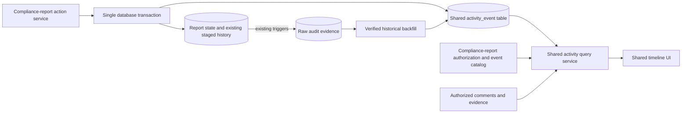

# Compliance-report activity timeline: system design

## Scope and recommendation

Implement the compliance-report activity timeline first, using a small shared event-log foundation that other application areas can adopt. Keep report workflow rules in the compliance-report service; share event persistence, pagination, API response structure, filters, and timeline presentation.

Capture new business events explicitly in the same database transaction as the report action. Keep the existing audit log as supporting evidence and a verified historical backfill source. Do not reconstruct the complete timeline from raw database changes on every request.

Preserve the current official staged history and Metabase views. The activity timeline supplements them with repeated transitions, assignments, comments, and meaningful processing activity.

Make **Report history** the default view of formal milestones: submission, analyst recommendation, manager recommendation and assessment. Let authorized users expand **Report activity** to follow the processing story, including assignment/reassignment, comments, returns, resubmissions and repeated recommendations. Use a consistent initiator name, date/time and action stamp in both views, subject to existing visibility and masking rules.

This document consolidates and replaces the earlier report review and generic design. Findings were checked against develop at e2c3e25988d8e844826d2b9a4258aa2e301e0a53. It is a proposed design, not implemented code or a production performance benchmark.

## Existing behavior and design implications

- ComplianceReportHistory is unique by report/status. Repeating a status updates its existing timestamps and actor. It cannot independently preserve every occurrence.
- Report versions have separate IDs and share compliance_report_group_uuid. Events need both version attribution and optional chain-wide retrieval.
- Analyst assignment has its own service path. Capture assignment events there, not only in the report status-update method.
- Existing audit records contain row-level snapshots and deltas. One business action can generate several records; row changes do not reliably identify formal intent.
- The configured audit trigger list does not include the report/comment association table. Current relationships cannot prove every historical association.
- Existing history filtering hides some internal statuses and masks government names for external viewers. A broader timeline needs explicit event- and field-level policy, including comment audience restrictions.
- The generic audit API uses OFFSET, exact counts, and full audit-row retrieval. It should not become the interactive timeline read path.

## Architecture and boundaries



Use the application's PostgreSQL database and existing transaction/session. Do not introduce a message broker, separate service, or full-refresh materialized view for the first release.

The shared append helper validates an event envelope and inserts it using the caller's transaction. It must not commit independently. Report state, required staged-history updates, event facts, and explicit reason/comment links commit or roll back together. Inspect transaction ownership in every integrated write path before wiring capture.

For concurrent status or assignment changes, use the existing authoritative concurrency mechanism or introduce an appropriate row lock/version check during implementation. Derive old/new event values from the state actually changed, not a stale client request. Define retries and operation idempotency together.

The semantic event record is durable business history. It is not a disposable projection: some meaning cannot be recovered from audit rows. Current-state tables remain authoritative for application state; this design does not require event sourcing. Any later read projection can be rebuilt from retained events.

### Latest staged history versus complete activity

These are separate read contracts, not two filters over the same list. Report history continues to use the existing staged-history source and its rules for the latest official sign-off at each stage/version. Report activity reads captured event occurrences: later actions append new events rather than overwriting earlier ones. An update to the staged-history row must not replace the earlier event or mutate its initiator, occurrence time or action facts.

For example, recommendation -> return -> recommendation again remains three occurrences in activity, while the official history continues to show the appropriate latest recommendation under its existing display rules. Selecting only formal events from activity would still include repeated recommendations and is therefore not equivalent to the official history. Expanding or filtering activity must not change the report's current version, status, staged-history selection or reporting outputs.

## Shared event model, mapped to reports

| Field | Compliance-report use |
|---|---|
| event_id BIGINT | Stable identity and chronological tie-breaker |
| subject_type | compliance_report |
| subject_id | Report-version ID, represented consistently in the shared schema |
| stream_id | compliance_report_group_uuid for chain-wide history |
| action_code | Namespaced action such as compliance_report.submitted |
| category | lifecycle, assignment, workflow, recommendation, decision, comment, content |
| importance | routine or formal, independent of category |
| occurred_at / recorded_at | Business occurrence time / capture time, in UTC |
| actor_id / actor_kind / role_at_action | Responsible user/system and historical capacity |
| action_id / event_ordinal | Retry-safe operation identity and event uniqueness |
| schema_version / source_kind / source_ref | Interpretation and provenance |
| data JSONB | Small validated action-specific facts |

Keep list-query keys and common filter dimensions relational. Validate data against the action's schema and impose a payload limit. Store approved status/assignee codes, decision outcomes, and references; avoid full report snapshots, rendered sentences, copied attachments, and unrestricted audit payloads.

Use explicit related-comment/evidence tables where needed. A report adapter validates subject existence, ownership, version-chain membership, and related references because generic subject IDs alone cannot enforce normal foreign-key integrity.

Historical actor identity and role must remain interpretable after reassignment or account changes. Define retained display-name treatment and masking with the data owner; a current user-directory join alone does not preserve a historical name.

## Compliance-report event catalog

| Event | Retained facts | Presentation |
|---|---|---|
| Created / supplemental created | Version and originating version where applicable | Lifecycle |
| Analyst assigned / unassigned / reassigned | Previous/new assignee; action actor | Routine assignment |
| Submitted / returned / other actual transition | Previous/new status; return target; related reason | Workflow |
| Analyst/manager recommendation | Explicit recommendation, actor capacity and related sign-off | Formal |
| Assessed / exempted / other supported decision | Actual outcome, version and sign-off reference | Formal |
| Comment added | Comment reference and author | Comment |
| Meaningful report edit | Approved changed-field summary and evidence references | Routine content |

Finalize action codes against actual business operations. Mark recommendations/decisions formal only when the operation is formally meaningful. A generic status change is not automatically a decision.

One operation should normally produce one primary story, carrying its status transition as detail. Do not duplicate a formal recommendation as both a recommendation entry and an indistinguishable status entry. If distinct events are useful, relate them through action_id and give each clear meaning.

Record actual outcomes. Direct assessment must not invent an intermediate analyst recommendation merely because prerequisite processing runs internally. Ignore timestamp-only churn in the user-facing log while preserving existing raw audit capture.

For report edits, begin with an approved, narrow catalog. Capture one meaningful save/import action where its transaction boundary is known; avoid one timeline item per changed database row. Do not claim complete schedule-edit coverage until those write paths are inventoried and integrated.

## Comments and reasons

Keep comments in their existing system. Show standalone authorized comments chronologically. When a return or formal action includes a reason/comment, save an explicit event-to-comment association in the same transaction. The action actor and comment author can differ.

Display an associated comment with the action; avoid repeating its full text as an unrelated second story. For lengthy comment groups, provide bounded expansion/pagination.

A mutable comment reference cannot preserve the original reason for a formal decision. Where that retention is required, reference an immutable comment revision or existing protected sign-off reason. This is an implementation prerequisite if the current comment system lacks revision support; do not silently claim historical immutability.

For legacy comments, timestamp proximity provides context, not proof of causation. Optional status-period grouping uses version-specific half-open intervals [start, next_start), computed from authoritative transitions before viewer filters. Keep standalone comments discoverable when boundaries are unknown or tied. Do not infer an explicit reason association.

Unauthorized comments must not reveal their existence through links, counts, badges, author names, or previews. Each comment destination independently enforces authorization.

## Read API and performance

A report-facing route delegates to the shared query service:

```text
GET /api/compliance-reports/{report_id}/activity
    ?scope=version|chain&limit=50&cursor=...
    &category=workflow&importance=formal

GET /api/compliance-reports/{report_id}/activity/{event_id}
```

The response envelope and query implementation are shared. An adapter registry supplies the compliance-report event catalog, policy, allowed filters, labels, and safe detail formatters. Later domains may expose matching routes without changing the shared storage or UI. Do not introduce a public generic router or plugin language merely to demonstrate reuse.

Read sequence:

1. Authorize the report and requested scope; resolve accessible versions for chain queries.
2. Apply event visibility and filters in SQL before pagination.
3. Fetch 51 compact authorized summaries for a 50-entry page; return has_more rather than an exact total.
4. Order by occurred_at and event_id, with a seek cursor bound to subject, scope, ordering and filters.
5. Batch actor/status lookups. Fetch approved details/comment bodies only on expansion, with independent authorization and size limits.

Default to newest-first; support oldest-first if required. An ID tie-breaker establishes deterministic presentation, not commit order or causality. Document refresh behavior for concurrent inserts and historical backfills. Strict consistent exports need a separate snapshot strategy.

Candidate indexes, subject to representative execution plans:

```sql
CREATE INDEX ON activity_event
    (subject_type, subject_id, occurred_at DESC, event_id DESC);

CREATE INDEX ON activity_event
    (subject_type, stream_id, occurred_at DESC, event_id DESC);

CREATE UNIQUE INDEX ON activity_event (action_id, event_ordinal);
```

Backfill also needs unique source identity/ordinal and live-capture reconciliation. Validate rare filters: finding 50 formal events among many routine edits may justify an importance/category-specific index. Do not create every filter permutation or a broad JSONB GIN index by default.

Keep the first release uncached. Add caching or an additional read projection only after measuring a real bottleneck; cache access must reflect subject permissions, visibility, comment changes, and policy version.

Proposed budgets: first-page API p95 <=250 ms under agreed concurrency; <=100 KB uncompressed summary payload for 50 entries; a fixed small query count; no full-history replay; and <=5% p95 write-latency regression. These are acceptance targets, not measured results. Benchmark realistic background audit volume, high-activity chains, rare filters, and bulk writes using execution plans and buffer/row-read measurements.

## Timeline UI and accessibility

Keep the official staged-history card as the default visible **Report history**. Add a collapsed **Report activity** disclosure that fetches processing events only when expanded; provide a dedicated panel/page when more space is needed. Activity expansion and field-level detail expansion are distinct controls. Do not fetch the complete activity stream simply to render the default report history.

Use the same stamp in both views: initiator display name, occurrence date/time and readable action. Apply existing name masking and authorization; use a system label for verified system actions and an explicit unavailable-initiator label when historical evidence cannot establish the actor. Never invent an initiator from the current assignee.

Illustrative sequence (oldest-first for readability; the activity API's default remains newest-first):

```text
Report history
  Initiator | Date/time | Submitted
  Initiator | Date/time | Recommended by analyst
  Initiator | Date/time | Recommended by manager
  Initiator | Date/time | Assessed

[Expand report activity]
  Initiator | Date/time | Submitted
  Initiator | Date/time | Analyst assigned
  Initiator | Date/time | Analyst reassigned
  Initiator | Date/time | Comment added
  Initiator | Date/time | Returned to supplier
  Initiator | Date/time | Resubmitted
  Initiator | Date/time | Analyst reassigned
  Initiator | Date/time | Recommended by analyst
  Initiator | Date/time | Comment added
  Initiator | Date/time | Recommended by manager
  Initiator | Date/time | Comment added
  Initiator | Date/time | Assessed
```

Each authorized activity entry retains its expandable change/evidence details. The example is not a mandatory workflow: only actions that actually occurred are shown, and restricted comments remain undisclosed.

Use a shared ActivityTimeline component receiving normalized events and catalog metadata. Show version context in chain view. Offer applicable filter groups, active selections and Clear; use AND across filter dimensions and OR within a selected dimension. Formal actions need a text label, not color alone.

Prefer explicit Load more to infinite scrolling. Provide keyboard-operable filters/details, semantic chronological lists, labeled controls, expanded/mixed states, visible unobscured focus, contrast, responsive reflow, and announcements for updated results. Preserve focus after filtering/loading. Validate applicable WCAG 2.2 AA criteria using keyboard, supported screen readers/devices, zoom/reflow and automated checks.

## Historical data, security and reporting

Backfill only verified audit evidence. Repeated status-history updates may retain prior values, but deployed triggers, retention, actor identity and reconstructability must be checked. Distinguish recorded history from inferred context and expose coverage gaps rather than fabricating events. Choose canonical evidence sources so report updates and history updates do not become duplicate transitions.

The audit trigger currently discovers one primary-key column per row despite the model describing composite-key support. Correctness and bulk-write overhead require review before adding association-table audit capture. Existing indexes do not establish efficient report-scoped audit retrieval.

Preserve current staged-history and Metabase semantics in this release. Review downstream Power BI/Metabase dependencies before any migration; publish a separate approved event-level reporting view only when needed. Event rows are not automatically a valid basis for status-duration analytics.

Start the new timeline with an explicit IDIR authorization policy; IDIR authentication alone does not grant every event/detail. Supplier-facing access is a separate policy extension preserving masking and internal-event restrictions. Never expose the generic audit API or raw old/new values.

Keep events and required evidence in PostgreSQL initially. Define retention with records/privacy owners. Defer partitioning/object-storage archival until growth justifies it; any purge requires verified retrieval, integrity and recovery for both summaries and expanded evidence.

## Reuse and implementation sequence

The reusable foundation is intentionally small: append helper, event envelope/table, cursor query service, catalog/policy adapter interface, and timeline/filter UI. Compliance-report services retain all report-specific workflow rules.

A future CI adapter can emit assignment, Verification 1/2, recommendation and decision events using this same envelope. Stage/cycle facts belong in its validated action payload; they do not become report-specific columns or shared workflow logic.

### Proposed ticket breakdown

Create one implementation epic, **Compliance-report activity timeline**, with the following child tickets. T1-T12 are planning identifiers, not existing GitHub issue numbers. Each implementation ticket includes its own automated tests; T11 provides cross-feature validation rather than postponing testing until the end.

| Step | Ticket | Type | Title | Depends on |
|---|---|---|---|---|
| 1 | T1 | Discovery / decision | Approve report event catalog, visibility and evidence policy | None |
| 2 | T2 | Backend / database | Add shared activity-event persistence and transactional append helper | T1 |
| 2 | T3 | Backend / API | Add report adapter and authorized cursor-based activity API | T2 |
| 2 | T4 | Backend / workflow | Capture report creation, assignment, transitions and formal actions | T2 |
| 3 | T5 | Backend / evidence | Preserve formal-action reasons and integrate comment activity | T3, T4 |
| 3 | T6 | Backend / content | Capture approved meaningful report edits | T4 |
| 3 | T7 | Frontend / feature | Add reusable story timeline, expandable details and filters behind a flag | T3 |
| 4 | T8 | Data discovery | Verify audit evidence and approve historical coverage rules | T1 |
| 4 | T9 | Data migration / tooling | Implement idempotent, reconciled historical-event backfill | T2, T4, T5, T8 |
| 4 | T10 | Full stack / transparency | Display historical coverage boundaries and evidence provenance | T7, T8 |
| 5 | T11 | Integration / accessibility | Validate workflow, authorization, paging and accessible interactions | T5, T6, T7, T9, T10 |
| 6 | T12 | Performance / release | Benchmark overhead and verify staged-history/reporting compatibility | T11 |

#### T1 - Approve report event catalog, visibility and evidence policy

- **Deliverable:** A reviewed action-code catalog, IDIR role/field visibility matrix, formal-versus-routine classification, and capture matrix mapping every in-scope operation to its authoritative service and transaction boundary.
- **Acceptance:** Define one primary story per business action; explicitly cover actual returns, repeated recommendations, direct assessment and supplemental versions. Identify the initial edit allowlist, comment audience rules, historical actor treatment, and whether formal reasons require immutable retention. Resolve these decisions with business and records/privacy owners before dependent implementation.
- **Boundary:** No supplier-facing timeline policy or additional domain adapter in this ticket.

#### T2 - Add shared activity-event persistence and transactional append helper

- **Deliverable:** Migration, typed event envelope/action-payload validation, related-evidence support, and a shared append helper using the caller's session.
- **Acceptance:** Enforce payload limits and action identity/ordinal uniqueness; support occurrence/capture times and provenance. The helper never commits independently. Tests demonstrate state/event rollback together and retry behavior without duplicate events. Add subject/stream indexes based on representative queries, without report-specific workflow columns.

#### T3 - Add report adapter and authorized cursor-based activity API

- **Deliverable:** Report version/chain summary and detail routes backed by shared query primitives and a compliance-report catalog/policy adapter.
- **Acceptance:** Authorize scope and accessible versions; apply visibility and AND/OR filter semantics before pagination. Default to 50 compact summaries plus `has_more`, with bounded limits and a stable time/ID seek cursor bound to scope/order/filters. Reject invalid or mismatched cursors explicitly. Batch lookups; independently authorize expanded details and comment references. Never return raw audit JSON or unauthorized counts.
- **Boundary:** Capture integration is T4; UI is T7. API tests use representative stored events.

#### T4 - Capture report creation, assignment, transitions and formal actions

- **Deliverable:** Transactional capture in report creation/supplemental creation, analyst assignment, status-update, recommendation and decision service paths.
- **Acceptance:** Persist actual prior/new state under authoritative locking/version checks; handle assignment, reassignment and unassignment. A failed action leaves neither state changes nor events. Retried operations do not duplicate events. Repeated statuses remain distinct occurrences, and direct assessment does not manufacture intermediate recommendations. Formal actions carry the actor's capacity and do not duplicate the same transition as a second indistinguishable story.
- **Latest-view protection:** Verify recommendation -> return -> recommendation preserves every activity occurrence without replacing its original initiator/time/action stamp, while existing staged-history rules continue to select the latest official sign-off.
- **Boundary:** Preserve existing staged-history writes and summary/transaction behavior; do not migrate history uniqueness without a separately approved consumer-impact decision.

#### T5 - Preserve formal-action reasons and integrate comment activity

- **Deliverable:** Comment-added capture, explicit action-to-comment/evidence links, and the approved immutable formal-reason representation.
- **Acceptance:** Link reasons atomically with actions; distinguish action actor from comment author. If current references cannot preserve required original reasons, implement protected revisions or use a verified existing immutable sign-off source before shipping formal-reason capture. Edited comments do not rewrite retained formal reasons. Show authorized standalone comments or safe links, avoid duplicate full-text stories for associated reasons, and bound comment expansion.
- **Privacy checks:** Restricted comments must not leak through counts, links, author labels, previews or attachments. Legacy timestamp grouping must not claim causation; filtering must not change underlying status-period boundaries.

#### T6 - Capture approved meaningful report edits

- **Deliverable:** Instrument only T1's approved save/import operations, using readable field labels and safe before/after facts.
- **Acceptance:** Emit one meaningful event per operation, not per changed row; exclude no-op and timestamp-only changes. Validate payload size and sensitive-field omission. Tests cover allowed changes, bulk/import behavior and rollback. Document excluded schedule/write paths so the UI does not imply complete coverage.

#### T7 - Add reusable story timeline, expandable details and filters behind a flag

- **Deliverable:** Shared timeline component, compliance-report entry point/preview, and integration with the existing feature-flag mechanism.
- **Acceptance:** Render localized actor/action/time stories with version context, formal-action text labels, and on-demand safe before/after details. Provide approved status/workflow, category and importance filters, active selections, Clear and explicit Load more. Verify empty/loading/error states, retry, bounded comment/detail expansion, stable focus, and keyboard-operable controls. Preserve the official staged-history card.
- **Default and expansion:** Show Report history by default and load Report activity on expansion. Use the same initiator/date/time/action stamp in both. Keep full-activity expansion separate from per-event detail expansion; filtering formal activity must not replace the latest-per-stage report history.
- **Flag behavior:** Use T1's approved IDIR policy. Disabling the flag hides the new UI and prevents UI activity fetches without changing existing report behavior. Document capture enablement separately so a display rollback does not accidentally discard required business history.

#### T8 - Verify audit evidence and approve historical coverage rules

- **Deliverable:** An evidence assessment using approved representative audit samples and deployed trigger/retention configuration, plus a mapping from source records to supported historical event types.
- **Acceptance:** Establish canonical evidence for transitions so report/history updates are not double-counted. Identify missing associations, actor/time uncertainty and retention gaps. Specify deterministic source identity/ordinal, historical source precedence, and live-capture cutover/reconciliation rules. Mark unverifiable event types/intervals unsupported rather than inferring formal intent.
- **Boundary:** Read-only discovery; no production backfill or source deletion.

#### T9 - Implement idempotent, reconciled historical-event backfill

- **Deliverable:** A bounded, resumable backfill command/job with dry-run reporting and an operational runbook.
- **Acceptance:** Enforce unique source identity/ordinal; preserve provenance, business time and recorded time. Re-running or resuming does not duplicate events. Reconcile candidates, inserted/skipped/unsupported records and overlap with live capture; surface failures explicitly. Test partial-batch failure and restart. Do not fabricate reason links or formal actions from status proximity.
- **Rollout gate:** Obtain operational approval for the target environment and review dry-run reconciliation before execution; do not delete raw audit evidence.

#### T10 - Display historical coverage boundaries and evidence provenance

- **Deliverable:** Authorized coverage metadata in the activity API and a visible timeline notice separating live capture, verified historical evidence and unknown intervals.
- **Acceptance:** Display incomplete-history notices even when filters yield no events. Never equate “no matching events” with complete history. Provide readable source/coverage detail without exposing restricted raw evidence; preserve ordinary cursor behavior when historical events arrive.
- **Dependency note:** Implement using T8's coverage contract; T11 validates against T9's backfill results.

#### T11 - Validate workflow, authorization, paging and accessible interactions

- **Deliverable:** Cross-feature integration/E2E scenarios and a documented accessibility check for the flagged report timeline.
- **Acceptance:** Cover rollback/retries, concurrent assignments/transitions, repeat statuses, direct assessment, supplemental-chain scope, edited/restricted comments and immutable reasons, historical/live overlap, tied timestamps, filtered page boundaries and bounded expansion. Validate keyboard/focus, screen-reader announcements, zoom/reflow, contrast and applicable WCAG 2.2 AA criteria. Include unauthorized detail/direct-link requests and flag-off regressions.

#### T12 - Benchmark overhead and verify staged-history/reporting compatibility

- **Deliverable:** Reproducible benchmark results, query plans, compatibility evidence, and a staged rollout/rollback checklist.
- **Acceptance:** Measure realistic background audit volume, high-activity chains, rare filters and bulk writes under agreed concurrency. Verify the proposed first-page p95 <=250 ms, <=100 KB uncompressed/50-entry summary response, fixed small query count and <=5% p95 write regression; resolve or explicitly review unmet targets before release. Compare official staged-history outputs and dependent Metabase/Power BI contracts before/after; do not change reporting semantics incidentally.
- **Operational checks:** Confirm retention ownership and growth monitoring. Keep object-storage archival outside the first release unless measurements justify a separately designed integrity/retrieval lifecycle. Record feature-flag rollout and UI rollback procedures without deleting captured events.

If T1 identifies a necessary change to `ComplianceReportHistory` semantics, create a separate **database/compatibility ticket** for migration, latest-per-stage derivation, and downstream-consumer tests before making that change. Similarly, immutable comment revisions belong in a separate prerequisite **evidence-retention ticket** if they are substantial enough to split out of T5. Do not create these speculative implementation tickets until their necessity is established.

A later domain should need its own capture integration, catalog and authorization adapter, without domain branches in the shared timeline component or a redesign of its pagination contract.
