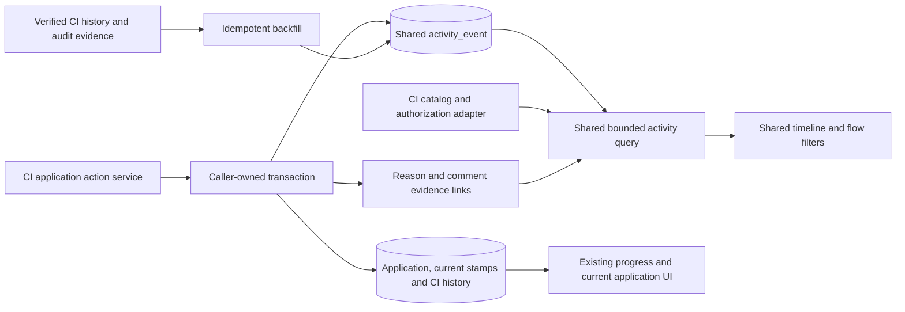

# CI application event log: system design

## Scope and recommendation

**Source:** [#5265 - Add CI Application Event Log](https://github.com/bcgov/lcfs/issues/5265). The issue body, all comments (none at review), and attached filter mockup were reviewed. This is a research/design deliverable based on the workspace at `716b9cca8`, not an implemented feature or a production benchmark.

Reuse the event envelope, transactional append helper, bounded query service and timeline/filter UI proposed in [Activity Timeline Design Spike](Activity-Timeline-Design-Spike.md). Add a CI-specific catalog, capture integration and authorization adapter; do not build a second event engine. Those shared primitives are proposed work, not assumed to exist already.

Keep the current CI progress display and current-state workflow semantics. Add a collapsed **Application activity** view for the full chronological processing story, including assignments, Verification 1/2, comments, returns, recommendations and decisions. Each event uses the same initiator, occurrence date/time and readable action stamp. Formal recommendations/decisions need explicit text labels and a filter, not color alone.

Capture future business events explicitly in the transaction that changes the application. Retain `CIApplicationHistory` and existing comment/progress surfaces during rollout. Use verified existing history snapshots and audit records for historical backfill, not raw database replay on every read. Do not copy compliance-report latest-per-stage overwrite behavior onto CI: CI history already appends rows.

The initial timeline is for authorized IDIR users. Applicant-facing history, new workflow stages, a new approval chain, and changes to existing access rules are outside scope.

## Issue interpretation and wireframe

The attached e-approvals-style image shows collapsible filter groups: Flow Actions, Document Actions and Form Actions. Flow Actions contains individually selectable actions such as Approved, Not Approved, Completed, Created, Forward, Re-opened and Task Completed; some are selected and others are not.

Adopt that grouped, expandable selection pattern, not those external workflow labels verbatim. CI filters must use actual supported actions: assignments, verification completions, returns, requests for information, recommendation and approval/completion. Do not introduce a "Not approved" event when the existing application has no matching rejection operation. Document/form filters should appear only for approved event capture, not imply every download, view or field edit is recorded.

| Issue requirement | Proposed implementation |
|---|---|
| Chronological assignments, unassignments, verification, returns, transitions and comments | Explicit CI action capture; one normalized stream ordered by occurrence time and event ID |
| Verification 1/2 analyst and relevant activity retained | Immutable completion facts with stage, responsible verifier, risk/priority facts and cycle context; preserve prior completions after resets |
| Formal recommendation/decision distinguishable from routine processing | Action-specific formal classification plus initiator capacity and related evidence; no invented manager-sign-off stage |
| Related comment/reason displayed with workflow event | Transactional event-to-comment/evidence reference; retain original reason where required |
| Main view not overwhelmed | Collapsed on-demand activity, bounded summary pages, Load more and separately bounded expanded details/comments |
| Keyboard/device support and WCAG 2.2 | Shared accessible disclosure/filter/detail controls plus CI-specific interaction checks |
| Existing data and reporting impacts assessed | Preserve current history/progress contracts, reconcile backfill sources, and review actual deployed Metabase/Power BI consumers before migration |

## Existing behavior and evidence

Paths are repository-relative. These are source-code findings; deployed records, trigger state and external dashboards were not inspected.

| Area | Finding | Source |
|---|---|---|
| History persistence | `add_history` inserts a new `CIApplicationHistory` with application ID, status, optional snapshot and inherited group/version. It does not upsert by status. A history row is not guaranteed to contain a complete application snapshot despite the model description. | `backend/lcfs/db/models/ci_application/CIApplicationHistory.py`; `backend/lcfs/web/api/ci_application/repo.py`, `add_history` |
| Assignment | Assign/reassign/unassign writes a named event snapshot with previous/new analysts, initiator and time. Assigning the same analyst is a no-op; Withdrawn applications reject assignment. | `backend/lcfs/web/api/ci_application/services.py`, `assign_analyst_to_application`, `_assignment_history_snapshot` |
| Verification | Completion stores current verifier/time and clears assignment. If assigned, its history snapshot describes unassignment rather than explicitly naming verification completion; otherwise the snapshot can be null. Verification 2 requires Verification 1 and Medium/High risk according to the service helper. The progress UI additionally recognizes legacy Moderate; do not assume the backend helper does. | Same service, `complete_verification_1`, `complete_verification_2`, `_requires_verification_2`; `frontend/src/views/CarbonIntensity/components/ciWorkflowHelpers.js` |
| Reset behavior | `_reset_government_workflow_review` clears verification and recommendation stamps; request-pathway-changes, request-documentation and return-to-first-verification use it. Earlier completion details cannot be recovered reliably from the current fields alone. | Same service, `_reset_government_workflow_review`, `request_pathway_changes`, `request_documentation`, `record_decision` |
| Returns | Returning Verification 2 to Verification 1 requires a reason and keeps status Submitted; it writes `verification_returned_to_first_verification`. Director return from Recommended to Submitted and reactivation from Withdrawn clear recommendation/approval stamps. | Same service, `record_decision` |
| Recommendation/decision | `recommend_to_director` accepts analyst, compliance-manager or director capacity but represents one recommendation operation. Approval requires director and Recommended status; its stored outcome is Completed. Current code does not define separate analyst and manager recommendation stages or a Not Approved status. | Same service, `recommend_to_director`, `record_decision`; `backend/lcfs/web/api/ci_application/views.py` |
| Additional information | Named history snapshots include `pathway_changes_requested`, `documentation_requested` and `supplemental_pathways_updated`; the latter retains before/after pathway facts. Draft risk saves, ordinary form saves and generated-code operations do not all provide equivalent semantic snapshots. | Same service, `update_risk_assessment_draft`, `update_step2`, `request_documentation`, `generate_fuel_codes`, `update_generated_fuel_code` |
| Existing presentation | Progress is derived from current stamps; assignment and verification-return histories have separate components. Comments use the shared comments UI in dual internal/public mode. These surfaces are not yet a unified, bounded event stream. | `frontend/src/views/CarbonIntensity/components/CIApplicationProgress.jsx`, `ciWorkflowHelpers.js`, `CIApplicationAssignmentHistory.jsx`, `CIApplicationReturnHistory.jsx`, `GovernmentDecisionStep.tsx` |
| Access | `CIApplicationValidation.validate_access` hides applicant Draft applications from government access; non-government access is organization-scoped. The new IDIR route must enforce both role and subject access, including details. | `backend/lcfs/web/api/ci_application/validation.py`; `views.py` |
| Comments | CI comments live in `InternalComment` and `CIApplicationInternalComment`, with visibility, audience metadata and attachments. Non-government comment reads are public-only and ownership checked. Audience-specific timeline policy still needs explicit review; do not assume audience metadata is already a per-role read restriction everywhere. | `backend/lcfs/web/api/internal_comment/services.py`, `get_internal_comments`; `backend/lcfs/db/models/comment/CIApplicationInternalComment.py` |
| Audit coverage | A migration introduced `ensure_audit_triggers()` for public tables except audit/version tables; a later migration invokes it again. CI tables were created after the first invocation. Coverage therefore cannot be judged from the original static table list alone or assumed for the entire historical interval. | `backend/lcfs/db/migrations/versions/2026-03-20-10-00_e8f1d2c3b4a5.py`; `2026-04-16-00-00_c1d2e3f4a5b6.py`; `2026-08-17-10-00_d7e2f4a9b1c6.py` |

## Architecture and shared boundaries



The shared append helper must not commit independently. Application state, verification/assignment facts, required existing history writes and reason links commit or roll back together. Generated-fuel-code approval effects must also retain their existing transaction behavior.

Inspect transaction ownership and locking in each write path. Concurrent assignments, verification completion and decisions must read the authoritative prior state under an appropriate lock/version check. Introduce operation idempotency before emitting events for retries. Event-ID ordering breaks presentation ties; it does not establish database commit order or causality.

Do not delete or repurpose existing history snapshots: they also feed assignment/return history and pathway changelogs. The new activity stream is durable semantic history, while current application fields remain authoritative for operational state.

### CI adapter and event envelope

Use the shared `subject_type=ci_application`, `subject_id`, `action_code`, category, importance, occurrence/capture timestamps, actor/capacity, operation identity/ordinal, schema version and provenance fields. Use `ci_application.*` action names.

Resolve application/group/version identifiers using CI's own relationships. CI inherits `group_uuid`/`version`, and pathways have their own versioning; this is not evidence that CI applications use the compliance-report supplemental-chain model. Begin with a single-application route. Add cross-application iteration retrieval only when membership and access semantics have been verified.

Keep verification stage and review-cycle facts in the validated action payload or typed evidence, not report-specific shared columns. An approved cycle definition must distinguish completed verification that was later reset from the active review. For new capture, record the reset and its source cycle explicitly; for historical records, do not manufacture a cycle number when evidence is insufficient.

## Proposed CI event catalog and capture points

Codes below are proposed, not existing API operations.

| Event / action | Capture point | Required retained facts / safeguards |
|---|---|---|
| `created`, `submitted` | `create_draft`, `submit_application` | Application identity, actual transition and verified initiator/signatory; exclude private applicant-draft details from IDIR output unless separately approved |
| `analyst_assigned`, `analyst_reassigned`, `analyst_unassigned` | `assign_analyst_to_application` | Prior/new assignee and initiating user; do not emit on same-assignee no-op |
| `verification_completed` with stage 1/2 | `complete_verification_1/2` | Verifier at completion, stage, business timestamp, applicable risk/priority and review-cycle facts; capture before later resets can clear them |
| Automatic assignment clearing | Same completion operation | Include previous assignee and clearing as a related effect of verification, not a second unexplained manual-unassignment story; retain operation correlation if separate events are needed |
| `returned_to_first_verification` | `record_decision` explicit return branch | Previous review progress, target stage, initiator, required original reason and reset/cycle context; status remains Submitted |
| `recommended` | `recommend_to_director` | Actual recommendation, role/capacity at action, occurrence time and evidence; stage prerequisite processing is not a second formal sign-off |
| `returned_to_analyst` | Recommended -> Submitted decision branch | Actual prior/new status, initiating director and related reason when supplied; preserve earlier recommendation as an event |
| `approved` | Completed decision branch | Director, actual Completed outcome, time and linked generated-fuel-code effects; do not emit both approval and an indistinguishable Completed story |
| `withdrawn`, `reactivated` | Appropriate `record_decision` branches | Actual prior/new status and authorized initiator; classify formal/routine with business owners rather than treating every decision endpoint call as a formal approval |
| `pathway_changes_requested`, `documentation_requested` | Corresponding request methods | Request kind, initiator, affected review cycle and reset effects, explicit related comment if supplied |
| `supplemental_pathways_updated` | Authorized supplemental `update_step2` | One meaningful save with safe approved change summary and pathway-version references; not a new report-style supplemental application |
| `comment_added` | Shared comment service for CI parent | Comment ID, authorized author/time and related action when explicitly provided; preserve visibility and attachment permissions |
| Optional approved content/document events | Reviewed form, upload and generated-code write paths | Whitelisted changes and evidence references; ticketed coverage decision required before filters imply these events exist |

Verification completion is a first-class processing milestone even when status stays Submitted. Risk/priority draft edits are not verification completion. Re-completion after a reset creates another occurrence; it must not overwrite the original verifier/date in the event stream.

The issue mentions analyst, manager and director formal actions. Current code offers one recommend-to-director operation with several permitted initiating roles. Preserve the actual role, but do not add a sequential manager stage or infer one from a role assignment. Any new business approval stage is a separate workflow requirement.

## Comments, reasons and expandable changes

Keep standalone authorized comments in the chronological stream. For a return/recommendation/decision with a supplied reason, retain an explicit event-to-comment or protected reason reference in the same transaction. The current return-to-first-verification snapshot already contains reason text; assess its retention/access guarantees before choosing it as immutable evidence.

If a formal reason must survive comment editing, use a protected comment revision or immutable action-reason representation approved by records/privacy owners. A mutable pointer is insufficient. Render current comment text as current, not as the unchanged original reason. Changes from Public to Internal must affect access to previews, linked details, caches and attachments.

Show all authorized comments created during a stage/status period, either inline or through a targeted comments link. Optional period grouping uses authoritative, application-specific boundaries before filters; retain standalone discoverability when boundaries are unknown. Both verifications can occur under Submitted, so a status-only grouping is insufficient for stage context. Temporal proximity does not prove a comment caused a return or recommendation.

Collapsed stories answer who, when and what. Expanded details show readable approved before/after values, including stage, old/new assignee, status and selected risk/priority or pathway fields. Resolve identifiers to safe labels, format timestamps consistently with existing UI helpers, bound large changes and never expose full snapshots, technical raw JSON, consultant contact data or document contents by default.

## Read API, filters and performance

Proposed CI-facing routes reuse the shared query contract:

```text
GET /api/ci-applications/{application_id}/activity
    ?limit=50&cursor=...&category=verification&stage=verification_2
GET /api/ci-applications/{application_id}/activity/{event_id}
```

Route spelling should follow the existing CI route conventions at implementation; these are design examples. No public generic audit router is required.

Authorize the caller and application first; enforce event/field/comment policy in both summaries and details. Apply all visibility and filters before seek pagination. Default to newest-first, fetch one extra compact summary for `has_more`, and bind cursors to application, filters and ordering. Reject invalid/mismatched cursors explicitly. Batch labels; load reason/comment/change details only when expanded with independent authorization and size limits.

| Filter group | CI choices |
|---|---|
| Flow actions | Assignment/reassignment/unassignment, verification completed, returned, requested information, recommended, approved, withdrawn, reactivated |
| Stage | Verification 1, Verification 2, recommendation/decision; stage is distinct from application status |
| Application status | Supported previous/resulting statuses with explicit matching semantics; choose resulting status for transitions, status-at-action for non-transition events |
| Importance / category | Formal versus routine; assignment, verification, workflow, recommendation, decision, comment and approved content |
| Document / form actions | Only event types whose write paths are explicitly integrated; hide unsupported groups |

Use AND across dimensions and OR within a dimension, show active selections and Clear. A verification-stage filter must not claim all Submitted actions belong to that stage. Include explicitly linked reasons with a matching event even if standalone comment events are filtered out, subject to permission; reset paging when filters change. Hidden comments must not leak via counts or badges.

Reuse subject/time/ID and operation-uniqueness indexes from the shared design. Profile rare stage/formal filters before adding a targeted index; avoid every filter permutation. Do not load all CI history snapshots or replay audit deltas for a page of activity.

Adopt the companion design's proposed, unmeasured acceptance budgets: first-page API p95 <=250 ms under agreed concurrency, <=100 KB uncompressed summary response for 50 entries, a fixed small query count, and <=5% p95 write-latency regression. Test verification and approval bulk effects, large comment collections and multiple review cycles, not only empty applications.

## UI mockup and accessibility

Keep current application progress and decision controls. Add a collapsed activity entry point near the existing summary/history area; migrate or consolidate separate history panels only after parity is demonstrated. Expanding activity must not change workflow/current stamps or reveal new applicant access.

```text
Application progress: Submitted -> Verification -> Recommended -> Completed
[Expand application activity]

Application activity
Flow actions [All]  Stage [All]  Importance [All]  [Clear]

Initiator | Date/time | Submitted the application
Initiator | Date/time | Assigned Analyst A to the application
Initiator | Date/time | Reassigned the application to Analyst B
Analyst B | Date/time | Completed Verification 1
  Verification 1 completed; analyst assignment cleared. [View details]
Initiator | Date/time | Assigned Analyst C for further review
Analyst C | Date/time | Completed Verification 2
Initiator | Date/time | Returned the application to Verification 1
  [View retained return reason] [View changes]
Analyst B | Date/time | Completed Verification 1 again
Analyst C | Date/time | Completed Verification 2 again
Initiator | Date/time | Recommended the application to the director [Formal]
  Associated comment: [View authorized comment]
Director  | Date/time | Approved the application [Formal]

[Load more]
```

The sequence is illustrative and oldest-first for readability, not a mandatory flow or an assertion about existing historical data. Low-risk applications need not undergo Verification 2. Only actually supported and recorded actions appear.

Reuse localized story templates and field labels, semantic lists, accessible disclosure/checkbox groups, explicit Load more, visible focus and announcements after filtering/loading. Expose expanded/collapsed and partial-selection states programmatically. Formal labels must not rely on icons/color. Validate WCAG 2.2 AA with keyboard, supported browser/screen-reader/device combinations, zoom/reflow, contrast and focus preservation.

## Historical reconciliation, privacy and reporting

Prioritize explicit named `CIApplicationHistory` snapshots for assignment, verification return and information-request evidence. Generic status-only/null snapshots can establish only the facts they actually retain. They do not prove which verifier completed an earlier reset cycle or that a role-specific formal recommendation occurred.

Verify deployed audit coverage and its effective start dates. The dynamic trigger migrations supersede assumptions based on the original static list; CI tables were created between trigger-maintenance invocations. Check live triggers, retention, actor attribution, row-key handling and reset evidence before promising a historical reconstruction. Audit old/new values can supplement evidence, not manufacture action intent.

Define canonical source selection and unique `(source_kind, source_ref, source_ordinal)` identity. A CI history row plus its audited update must not become two timeline actions. Reconcile backfill with live operation capture around an explicit cutover; retain business time separately from backfill insertion time. Make the job resumable, dry-run capable and bounded; report inserted, duplicate, unsupported and failed candidates. Expose coverage gaps in the UI even for empty filtered results.

Do not introduce a compliance-report latest-per-stage migration. Preserve CI assignment/return snapshot interpretation, pathway changelogs, progress/current fields and generated-fuel-code relationships. Current workflow stamps can reset while prior event facts remain intact.

Review deployed Metabase/Power BI dashboards and CI/fuel-code consumers with reporting owners; no CI-specific SQL view references were found in the repository's views directory, which does not establish that external dashboards do not exist. Keep existing reporting semantics and grants. An event-level reporting view is separate approved work; events are not automatically valid status-duration metrics.

Use explicit IDIR event/field policy, existing subject authorization and independently protected comments/attachments. Applicant Draft details are not made visible merely by appending an event. Where actor evidence is unavailable, show an unavailable/system label as appropriate, never the current assignee as a substitute initiator.

Retain events and required evidence in PostgreSQL initially. Measure growth and agree retention with records/privacy owners before designing object-storage archival. Later archival must retain provenance, original reasons and expanded-detail retrievability with integrity checks, manifest lookup and recovery verification before any source purge; no per-application mutable JSON blob as the sole authoritative history.

## Risks and decisions

| Risk / decision | Required resolution |
|---|---|
| Shared foundation is not yet implemented | Coordinate with the compliance-report epic; implement/reuse shared primitives once, independently of CI workflow rules |
| Verification reset loses current stamps | Capture completion and reset facts atomically; preserve prior cycles instead of projecting solely from current fields |
| Completion automatically clears assignment | Present as a related effect with operation correlation; distinguish automatic from manual unassignment |
| Formal roles versus actual workflow | Approve formal classification and role-at-action; do not invent manager recommendation or rejection stages |
| Reason mutation / comment visibility | Agree protected reason retention and per-role access, including edited/restricted comments and attachments |
| Historical evidence is partial | Verify snapshots, audit coverage and actor/time evidence; expose unknown periods without inferred causal links |
| History consumers and downstream reporting | Preserve current progress, assignment/return and pathway/fuel-code contracts; review deployed BI dependencies |

## Proposed ticket breakdown

Create a **CI application event log** epic linked to #5265 and the shared activity-timeline work. CI1-CI10 are planning identifiers, not created issues. Every implementation ticket includes focused automated tests.

| ID | Type | Ticket | Dependencies |
|---|---|---|---|
| CI1 | Discovery / decision | Approve CI action catalog, stage/cycle meaning, formal semantics and visibility | None |
| CI2 | Backend / shared adapter | Add CI catalog/policy adapter and authorized bounded read API | CI1; shared persistence/query contract |
| CI3 | Backend / workflow | Capture assignments, verification completions and resets atomically | CI1; shared transactional append helper |
| CI4 | Backend / workflow | Capture submission, recommendation, returns and decisions | CI3 |
| CI5 | Backend / evidence | Link CI comments/reasons and approved information/change events | CI2, CI4; approved reason-retention representation |
| CI6 | Frontend / feature | Add flagged CI story timeline, grouped filters and expanded details | CI2; shared timeline UI |
| CI7 | Data discovery | Verify CI history/audit evidence and coverage rules | CI1 |
| CI8 | Data migration / transparency | Backfill verified CI evidence and expose provenance/coverage | CI3, CI4, CI5, CI7; CI6 for UI coverage display |
| CI9 | Integration / accessibility | Validate review cycles, permissions, filters and accessibility | CI5, CI6, CI8 |
| CI10 | Performance / release | Benchmark CI read/write overhead and verify existing behavior/BI compatibility | CI9 |

### CI1 - Approve CI action catalog, stage/cycle meaning, formal semantics and visibility

Deliver a write-path capture matrix and IDIR role/field policy. Specify verification-stage versus status meaning, reset/re-completion cycle semantics, reason retention, current versus historical actor identity, and permitted content/document events. Confirm which initiating roles count as formal actions without adding new stages. Approve treatment of applicant-created history and restricted comments. No new supplier-facing timeline scope.

### CI2 - Add CI catalog/policy adapter and authorized bounded read API

Implement CI subject resolution, allowed filters, localized action labels and safe detail formatters on the shared primitives. Enforce subject/event/detail authorization, stable cursor binding, bounded pages and filter-before-pagination. Tests cover hidden Draft subjects, unauthorized details/comments, tied timestamps, invalid cursors and stage/status filter differences. If shared primitives are absent, split a shared prerequisite ticket rather than duplicating storage/query/UI logic in CI.

### CI3 - Capture assignments, verification completions and resets atomically

Integrate assign/unassign/reassign and both verification methods, plus the workflow reset call sites. Preserve verifier/time, reviewed facts and reset/cycle context before clearing current fields. Capture automatic clearing as a correlated effect. Tests cover no-op assignments, Withdrawn restrictions, stage prerequisites, Low versus Medium/High, legacy Moderate display versus backend validation, retries, rollback and concurrent assignment/completion. Do not change current workflow validation as part of logging.

### CI4 - Capture submission, recommendation, returns and decisions

Integrate the authoritative service branches and existing history writes within the same transaction. Distinguish return-to-first-verification (Submitted remains Submitted), director return, withdrawal/reactivation and Completed approval. Preserve earlier recommendation/approval facts after resets; capture actual role, not an assumed analyst/manager stage. Approval logs once alongside existing generated-code effects. Verify retries and failures roll back state/evidence/events together.

### CI5 - Link CI comments/reasons and approved information/change events

Capture standalone comments through the shared comment service; atomically associate workflow reasons where explicitly provided. Preserve required original return/formal reasons via approved protected evidence or a prerequisite immutable-revision ticket. Integrate pathway/document requests and supplemental pathway changes; inventory actual upload/form/generated-code paths before adding their events. Test edited/public-to-internal comments, restricted attachments, associated-reason deduplication and bounded detail payloads.

### CI6 - Add flagged CI story timeline, grouped filters and expanded details

Wire the shared component without replacing current progress/history panels until parity is proven. Include initiator/date/action stories, explicit Formal labels, expandable safe changes, stage/workflow/status filters, active selections, Clear and Load more. Disclose which document/form actions are supported. Verify loading/empty/error/retry and focus behavior. Flag-off hides the UI and its fetches; define capture rollout separately so display rollback does not discard required event history.

### CI7 - Verify CI history/audit evidence and coverage rules

Read-only review of approved representative history/audit samples and deployed trigger/retention state. Define trustworthy action mappings, source precedence, cutover, unique provenance, cycle uncertainty and unreconstructable intervals. Explicitly test the case where a verification history snapshot records only automatic unassignment. Never infer a completion or reason association solely from a status-only row.

### CI8 - Backfill verified CI evidence and expose provenance/coverage

Provide a bounded/resumable dry-run command and reviewed execution runbook. Enforce source uniqueness/ordinal, reconciliation with live capture and restart safety. Compare candidate/inserted/skipped/unsupported/error counts and verify business timestamps. Expose coverage boundaries even on empty filtered pages, without leaking restricted evidence. No source deletion and no production execution without operational approval.

### CI9 - Validate review cycles, permissions, filters and accessibility

Extend `backend/lcfs/tests/ci_application/test_ci_application_service.py`, `test_ci_application_repo.py`, `test_ci_application_views.py`, and existing CarbonIntensity UI tests as appropriate. Cross-feature scenarios cover repeated verification after reset, recommendation -> return -> recommendation, assignment races, decision rollback, same-status returns, edited/restricted reasons, backfill/live overlap, filter/page boundaries and generated-code effects. Validate keyboard, screen readers, focus, contrast and zoom/reflow against applicable WCAG 2.2 AA criteria.

### CI10 - Benchmark CI read/write overhead and verify compatibility

Measure the proposed shared budgets with large CI histories, multiple cycles, restrictive stage/formal filters and approval bulk effects. Review execution plans and fixed query counts. Compare current progress, assignment/return histories, pathway changelogs, comment controls and linked fuel-code outputs before/after. Obtain reporting-owner review of deployed dashboards, record retention/growth ownership, and provide feature-flag rollout/rollback steps without deleting captured events.

## Completion boundaries

This spike recommends the design and ticket split only. Business-policy approvals, deployed audit verification, performance measurements, actual implementation, ticket creation, migrations and backfill execution remain future work. The proposed timeline adds observability; it does not alter CI approval roles, status transitions or applicant access.
