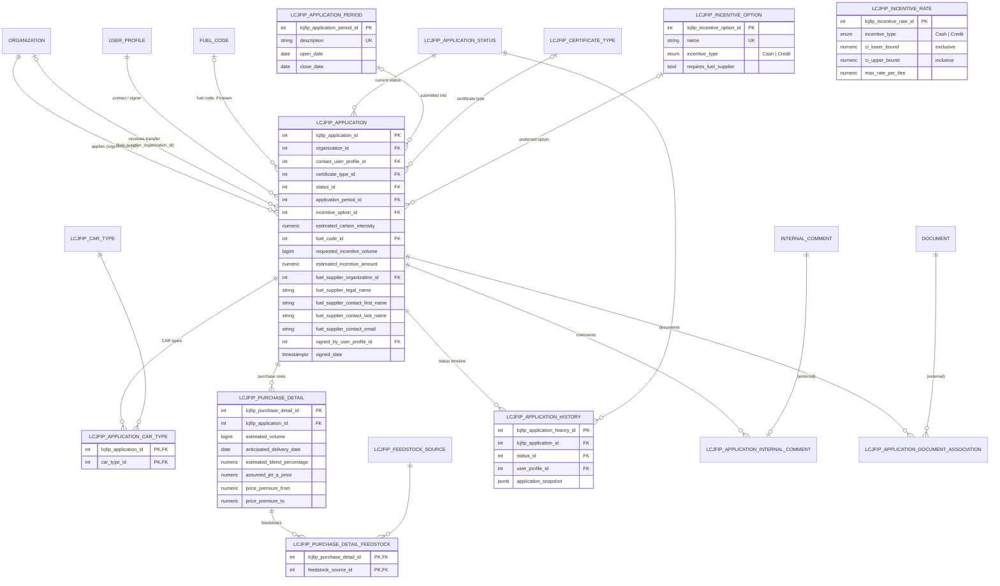

# ERD: LCJFIP Domain

Data model for the Low Carbon Jet Fuel Incentive Program (LCJFIP) application (#5501), in `backend/lcfs/db/models/lcjfip/`. It covers the application form (applicant, LCJF purchase details, preferred incentive, fuel supplier transfer, signing authority), the workflow around it (status, intake period, history, comments, documents), and the Metabase views. It was designed so the later stages — award letter (#5284), disbursement letters (#5285, #5286) and delivery verification — attach to it without reshaping it. Those later tables are proposed under [Planned extensions](#planned-extensions), not built.

Migration: `810923914d50` (`2026-11-17-10-00_810923914d50.py`).

See also: [Organization Domain](ERD-Organization-Domain.md), [Fuel Domain](ERD-Fuel-Domain.md), [Database Schema Overview](Database-Schema-Overview.md).

## Diagram

`LCJFIP_INCENTIVE_RATE` has no foreign key. It joins to an application through `incentive_option.incentive_type` and the application's `estimated_carbon_intensity` (see [Derived values](#derived-values)). Every table carries the standard audit columns: `create_date`, `update_date`, plus `create_user` and `update_user` on all but the two-key link tables. Every select-list lookup (`car_type`, `certificate_type`, `feedstock_source`, `incentive_option`) also carries `display_order`, `effective_date`, `effective_status` and `expiration_date`, so an option can be retired without deleting it.

## Entities and cardinality

| Table | Purpose | Relationship |
|---|---|---|
| `lcjfip_application` | One application | organization 1 : N applications |
| `lcjfip_purchase_detail` | One row of the LCJF purchase grid | application 1 : N purchase rows |
| `lcjfip_purchase_detail_feedstock` | Feedstocks of a purchase row | purchase row M : N feedstock source |
| `lcjfip_application_car_type` | CAR types held by the applicant | application M : N CAR type |
| `lcjfip_application_history` | Status changes with a JSONB snapshot | application 1 : N history rows |
| `lcjfip_application_internal_comment` | Link to the shared comment framework | application 1 : N comments |
| `lcjfip_application_document_association` | Link to the shared `document` table | application M : N documents |
| `lcjfip_application_status` | Workflow status lookup | status 1 : N applications |
| `lcjfip_application_period` | Intake rounds | period 1 : N applications (0..1 per application) |
| `lcjfip_certificate_type` | Certificate type lookup | type 1 : N applications (0..1 per application) |
| `lcjfip_car_type` | CAR operation type lookup | see link table |
| `lcjfip_feedstock_source` | Feedstock source lookup | see link table |
| `lcjfip_incentive_option` | Preferred incentive option lookup | option 1 : N applications (0..1 per application) |
| `lcjfip_incentive_rate` | Max rate per litre by type and CI band | joined by type + CI, no FK |

Deleting an application (only Drafts can be deleted) cascades in the database to its purchase rows, their feedstock links, CAR type links, history, and comment and document links. The `internal_comment` and `document` rows themselves are left for their own services to delete (the S3 object must go too). Deleting a fuel code sets `fuel_code_id` to NULL. Every other foreign key restricts deletes.

## Design decisions

**Primary entity.** `lcjfip_application` belongs to the applicant organization (`organization_id`, the logged-in BCeID user's organization) and names one applicant contact (`contact_user_profile_id`, the user who created it). The award and disbursement letters quote that contact. The address, phone and email shown on the form are read live from `organization` and `user_profile`, not copied. The history snapshot freezes them at each status change.

**Purchase details** are a child table, never repeated columns on the application. Each grid row is one `lcjfip_purchase_detail`.

**CAR types are many-to-many; certificate type is a single FK.** The form offers a single selection, but the label says "type(s)", and an operator can hold authority under more than one CAR subpart. The link table costs little and makes multi-select a UI-only change later. Moving from a single FK to a link table would instead mean a data migration. An operator has one certificate type, so that stays a plain FK.

**Feedstock sources are many-to-many per purchase row.** A purchase can blend feedstocks. LCFS has no shared feedstock table (`fuel_code.feedstock` and `pathway.feedstock` are free text), and this list is program-specific ("Unknown / To be determined"), so it gets its own `lcjfip_feedstock_source` lookup.

**Incentive fields live on the application; no separate incentive entity for the request.** The requested incentive (option, CI, fuel code, requested volume, estimated amount) is 1:1 with the application, entered on the same form, and has the same lifecycle. A separate table would add a join and no flexibility. The government's award, and later its disbursements, *are* separate entities with their own lifecycle (see [Planned extensions](#planned-extensions)).

**Three incentive options are rows in `lcjfip_incentive_option`.** Each row carries two flags:
- `incentive_type` (`Cash` or `Credit`), which sets the unit of the amounts: CAD or LCFS credits.
- `requires_fuel_supplier`, which turns on the fuel supplier fields.

Validation reads these flags rather than matching on option labels.

**Fuel supplier transfer links to an existing organization where possible.** LCFS credits can only be transferred to a registered organization, so `fuel_supplier_organization_id` (FK to `organization`) is the primary way to name the supplier. Its legal name is `organization.name` and is not copied. `fuel_supplier_legal_name` is a fallback for a supplier not yet in LCFS, and a CHECK constraint stops both being set. The contact name and email are specific to the application (the person may not be an LCFS user), so they are stored as entered. The fields stay inline on the application rather than in a 1:1 table: they are only five columns of the same form.

**Application period.** The form says staff review applications "at the close of the current application period", and the letters quote an "[Application Period]". `lcjfip_application_period` models those intake rounds. The period is assigned on submission, not on creation, so a draft started in one round and submitted in the next belongs to the next. `compliance_period` was considered and not reused: it is a calendar supply year, not an intake window with open and close dates.

**Incentive rates are reference data, not code.** The "Carbon intensity baseline incentive rates" table on the form is seeded into `lcjfip_incentive_rate` with effective dates. The form, the submission check and the reporting view all read the same numbers. A rate applies on a date when `effective_date <= date < expiration_date`: as for fuel codes, `expiration_date` is the first day the rate no longer applies. To change a rate, set the old row's `expiration_date` to the new row's `effective_date`.

**Comments and documents reuse the shared frameworks.** `lcjfip_application_internal_comment` follows `ci_application_internal_comment`. The "Comments to the Government of B.C." thread is the same `internal_comment` table with `visibility = 'Public'`. A new Comment Log category, "LCJFIP application notes", is seeded. `lcjfip_application_document_association` follows the other `*_document_association` tables for uploads and generated letters.

**No `Versioning` mixin.** Applications have no supplemental versions. `lcjfip_application_history` keeps the audit trail instead, like `ci_application_history`.

### Reuse assessment

| Need | Reused | New, and why |
|---|---|---|
| Applicant and fuel supplier | `organization` | — |
| Contact and signer | `user_profile` | — |
| Fuel code, if known | `fuel_code` (FK, not free text) | — |
| Comments | `internal_comment`, `comment_category` | link table only |
| Documents and letters | `document` + S3 | link table only |
| Feedstocks | — | no shared feedstock table exists |
| CAR and certificate types | — | program-specific lists |
| Intake rounds | `compliance_period` considered | needs open and close dates |
| Status | — | own lifecycle, as CI applications have |
| Reporting role | `basic_lcfs_reporting_role` | two views |

## Fields, types and requirements

The database enforces only what holds in every status, so a Draft saves with any field empty. Completeness is checked when the application is submitted. Fields marked "on submit" below are the submission rules for the API story to implement.

| Field | Type | Required |
|---|---|---|
| `organization_id`, `contact_user_profile_id`, `status_id` | int FK | always (set by the system) |
| CAR types (link table) | M:N | on submit, at least one |
| `certificate_type_id` | int FK | on submit |
| `incentive_option_id` | int FK | on submit |
| `estimated_carbon_intensity` | numeric(10,2) gCO2e/MJ, may be negative | on submit |
| `fuel_code_id` | int FK | optional ("if known") |
| `requested_incentive_volume` | bigint litres, >= 0 | on submit, > 0 |
| `estimated_incentive_amount` | numeric(15,2), CAD or credits by option, >= 0 | on submit, > 0 |
| `fuel_supplier_organization_id` or `fuel_supplier_legal_name` | int FK / varchar(500), not both | on submit when the option `requires_fuel_supplier`; empty otherwise |
| `fuel_supplier_contact_first_name`, `_last_name` | varchar(100) | same as above |
| `fuel_supplier_contact_email` | varchar(255) | same as above |
| `application_period_id` | int FK | set on submit |
| `signed_by_user_profile_id` + `signed_date` | int FK + timestamptz, set together | set on submit |
| Purchase rows | child table | on submit, at least one |
| `estimated_volume` | bigint litres, >= 0 | on submit, > 0 |
| `anticipated_delivery_date` | date | on submit |
| Feedstock sources (link table) | M:N | on submit, at least one |
| `estimated_blend_percentage` | numeric(5,2), 0 to 100 | on submit, > 0 |
| `assumed_jet_a_price` | numeric(10,4) CAD/L, >= 0 | on submit |
| `price_premium_from`, `price_premium_to` | numeric(10,4) CAD/L, >= 0, from <= to | on submit |

Precision follows existing LCFS columns: whole litres as `bigint` (like `fuel_supply.quantity`), carbon intensity as `numeric(10,2)` (like `fuel_code.carbon_intensity`). Prices use four decimals so rates like 0.0075 credits/L and sub-cent prices fit. The blend ratio is stored as a percentage and named `estimated_blend_percentage`, so nobody multiplies a volume by "30" thinking it is a fraction.

### Derived values

These are computed, not stored:

| Value | Source |
|---|---|
| Application-level "Estimated total volume for support (L)" | `SUM(lcjfip_purchase_detail.estimated_volume)`, read-only on the form |
| Price premium validation | `price_premium_to - price_premium_from <= 0.25` CAD/L (see open question 4) |
| Application number | `'LCJFIP-' \|\| lcjfip_application_id`, like CT/AA/IA display codes |
| Incentive unit | `incentive_option.incentive_type`: Cash → CAD, Credit → credits |
| Maximum rate | the `lcjfip_incentive_rate` row for that type where `ci > ci_lower_bound` and `ci <= ci_upper_bound`, in effect on the Pacific submission date (`effective_date <= date < expiration_date`) |
| Maximum eligible incentive | `requested_incentive_volume × maximum rate` |
| Submitted date | `signed_date`. First submission and decision dates come from history |
| Fuel supplier name, when linked | `organization.name` |

Some values are stored but checked on submit: `requested_incentive_volume` must not exceed the total purchase volume, and `estimated_incentive_amount` must not exceed the maximum eligible incentive. Choosing a fuel code pre-fills `estimated_carbon_intensity` from `fuel_code.carbon_intensity`, but the CI is stored because applicants may estimate one without a code.

### Integrity constraints

| Constraint | Rule |
|---|---|
| `ck_lcjfip_application_requested_volume_non_negative` | requested volume >= 0 |
| `ck_lcjfip_application_incentive_amount_non_negative` | estimated amount >= 0 |
| `ck_lcjfip_application_fuel_supplier_org_or_name` | not both a linked supplier and a typed name |
| `ck_lcjfip_application_signature_complete` | signer and signed date set together |
| `ck_lcjfip_purchase_detail_volume_non_negative` | volume >= 0 |
| `ck_lcjfip_purchase_detail_blend_percentage_range` | 0 <= blend <= 100 |
| `ck_lcjfip_purchase_detail_jet_a_price_non_negative` | Jet-A price >= 0 |
| `ck_lcjfip_purchase_detail_premium_non_negative` | premium bounds >= 0 |
| `ck_lcjfip_purchase_detail_premium_range_ordered` | premium from <= to |
| `ck_lcjfip_application_period_close_after_open` | close date >= open date |
| `ck_lcjfip_incentive_rate_ci_bounds_ordered` | lower bound < upper bound |
| `ck_lcjfip_incentive_rate_max_rate_positive` | rate > 0 |
| `uq_lcjfip_*_name`, `uq_lcjfip_application_status_status`, `uq_lcjfip_application_period_description` | unique lookup labels |

Rules that depend on the status or on other tables are enforced on submit, not by CHECK constraints: anything conditional on the incentive option, volume totals, rate caps, and the $0.25 premium rule. A CHECK constraint cannot read another table, and policy values like the $0.25 cap may change by period.

## Metabase

Two views, granted to `basic_lcfs_reporting_role` and kept in `backend/lcfs/db/sql/views/metabase.sql`:

- **`vw_lcjfip_application_base`**, one row per application. It has the labels resolved, CAR types as a list, purchase count and total volume, incentive type and unit, and the amount split into `estimated_incentive_cad` and `estimated_incentive_credits` so a sum never mixes dollars with credits. It also has the maximum rate and maximum eligible incentive, the fuel supplier name with a "registered in LCFS" flag, and the first submitted, last submitted and decision dates.
- **`vw_lcjfip_purchase_detail_base`**, one row per purchase row. It has the application context, the delivery year, feedstocks as a list with a count, and the price premium range width.

Rules in both views:
- **Drafts are excluded.** They are the applicant's private work, and government users do not see Drafts anywhere else in the portal.
- **Contact names and emails are excluded.** Reporting does not need them.
- **Timestamps are in Pacific time** (`AT TIME ZONE 'America/Vancouver'`), so date filters match the portal.
- **Volume by feedstock needs care.** A blended purchase lists several feedstocks, so grouping `estimated_volume` by feedstock double counts. Filter on `feedstock_source_count = 1`, or treat multi-feedstock rows as their own group.
- **Joins:** use `lcjfip_application_id`, `organization_id` and `application_period_id`. They match the base tables, so the views join to each other and to existing organization reporting.

Metabase imports PostgreSQL column comments as field descriptions, and every new column has one.

**The reporting role reads LCJFIP only through the views.** Where the role was created by `create_role_if_not_exists` (in migrations or `manage_views.py`), `ALTER DEFAULT PRIVILEGES` gives it `SELECT` on every new table. That would expose Drafts, contact details and history snapshots through the base tables. So the migration revokes the role's access to all 14 base tables after creating them. The views keep working, because they read the base tables with their owner's privileges. A test checks that only the two views are readable. Any LCJFIP table added later needs the same revoke, and the test fails until it is added to its list.

After deployment, run a Metabase schema sync so the views appear.

## Migration and reference data

`810923914d50` (on `9e0e5741b48f`) does the following:
1. Creates the `lcjfip_incentive_type_enum` type and the 14 tables.
2. Seeds the lookups: 4 statuses, 4 CAR types, 5 certificate types, 12 feedstock sources, 3 incentive options and 4 rates.
3. Seeds the "LCJFIP application notes" comment category.
4. Creates the two views from `metabase.sql`.
5. Revokes the reporting role's access to the 14 base tables.

Downgrade drops all of this, including any LCJFIP comments.

No application period is seeded: the first intake round's name and dates are still to be confirmed (open question 5). Until a period exists, submission has no period to assign. Development data can insert one.

Each open PR that adds a migration on `9e0e5741b48f` will need its `down_revision` re-pointed at whichever lands second.

## Planned extensions

These are not built. They are sketched so the model above holds them without change.

- **`lcjfip_incentive_award`** (0..1 per application). Approved LCJF volume, approved rate, approved amount (unit from the option), award letter date and reference, decided by and decided at. This is the source for the Incentive Award Letter (#5284). It is sized against overall program demand per period, which may add a budget to `lcjfip_application_period`.
- **`lcjfip_delivery_verification`** (0..N per application, or per purchase row). Delivered volume and date, verified CI or fuel code, and documents. The final incentive is calculated from these rows.
- **`lcjfip_disbursement`** (0..N per award). Authorized amount in CAD or credits, recipient organization, disbursement letter date and reference, and, for credits, a `transaction_id` FK to the ledger `transaction` table. This is the source for the disbursement letters (#5285, #5286), whose table can list more than one disbursement.
- **IDIR review fields** such as an assigned analyst or a recommendation step, if the review workflow needs them (as on `ci_application`).

## Open questions for Product Owner review

1. **CAR types:** single or multiple per application? (The link table supports both. The form is single-select.)
2. **Feedstocks:**
   - Several per purchase row? (Supported.)
   - Should "Other" require a free-text description? (No column exists yet.)
   - Is "Unknown / To be determined" exclusive of the other sources?
3. **Requested volume:**
   - Is "Total volume of LCJF incentive requested" capped by the total purchase volume?
   - Or is it the neat LCJF volume, the sum of volume × blend %? In other words, do the per-litre rates apply to blended or neat litres?
4. **Price premium rule:** does "the price premium range must not exceed $0.25 CAD/L" limit the width of the range (to − from) or its upper value? The model assumes the width.
5. **Application periods:**
   - Confirm that intake rounds exist, with the first round's name and dates.
   - Can an organization submit more than one application per period?
6. **Estimated incentive amount:** entered by the applicant (modelled), or always calculated as requested volume × maximum rate?
7. **Statuses:**
   - Confirm the names Draft, Submitted, Approved and Rejected.
   - Which IDIR review steps are needed (recommendation, return to applicant, withdrawal)?
8. **Fuel supplier:** must the transfer recipient be an LCFS-registered organization? If so, the free-text fallback can be dropped.
9. **Carbon intensity and fuel code:** these sit at the application level, as on the form. Should they move to each purchase row when rows come from different producers?
10. **Letters:** should letters use the organization address at submission (from the history snapshot) or the current address?
